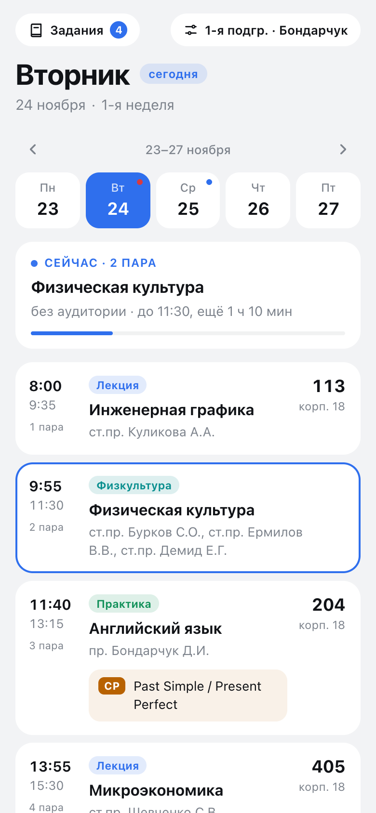
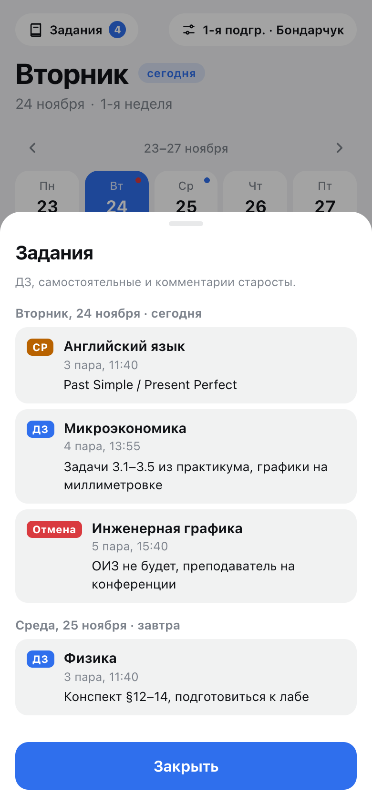
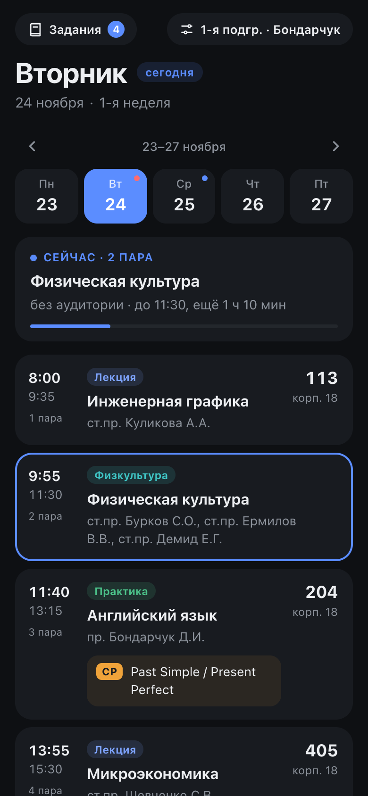

# Расписание группы — приложение с режимом старосты

Удобное расписание для своей учебной группы в БНТУ вместо общего, которое то не открывалось, то показывало не то.
Одна страница, которая ставится на телефон как приложение, работает без интернета, сама знает, какая сейчас неделя,
а староста отмечает в ней домашку, самостоятельные и отмены пар. Пользуется вся группа.

*A schedule web app (PWA) for a university group: offline-first, installable on iPhone and Android,
with a "class monitor" mode for homework, quizzes and cancellations. Vanilla JS + Python standard library, no build step.*

**Живой сайт:** https://rasp.130-49-141-77.sslip.io

<p>
  
  
  
  
  
</p>

<sub>На скриншотах демо-отметки, не настоящие задания группы.</sub>

## Что умеет

**Для всей группы**
- Сама считает, какая неделя — 1-я или 2-я, и показывает пары именно на выбранную дату.
- «Сейчас идёт 2 пара, ещё 1 ч 10 мин» или «Дальше через 15 минут, ауд. 405». В выходные — «Завтра к 8:00».
- Подгруппы: каждый один раз выбирает свою (лабы и английский), чужие пары пропадают.
- Окна между парами, свайп по дням, переход к сегодняшнему дню одним касанием.
- Отметки старосты видны прямо на парах, точки в полоске дней и общий список «Задания» со счётчиком.
- Работает без интернета: оболочку хранит service worker, данные — сама страница.
- Ставится на главный экран: внутри есть инструкция для iPhone и Android, в Chrome — кнопка «Установить»,
  в Telegram — «Добавить на главный экран».
- Светлая и тёмная тема, внутри Telegram подхватывает его цвета.

**Для старосты** (вход по коду, остальные только смотрят)
- **ДЗ** — по умолчанию само встаёт на следующую такую же пару (тот же предмет, тип и подгруппа).
- **СР** — самостоятельная на этой или следующей паре.
- **Комментарий** — «пары не будет», другая аудитория или просто заметка; можно на весь день.
- Исправить или удалить — нажатием на отметку.
- Сервер принимает правки только с кодом и закрывает вход после серии неверных попыток.

## Как устроено

```
web/                 страница без сборки: HTML, CSS, JS
  data/schedule.json расписание на семестр (недели, пары, подгруппы)
  data/changes.json  разовые правки поверх расписания
  sw.js              офлайн-кэш
server.py            сервер на стандартной библиотеке Python: страница + API отметок
deploy/              служба systemd, блок Caddy и скрипт выкладки
```

- **Фронтенд** — чистый JavaScript, без фреймворков и сборщиков. Расписание описано данными, а не версткой:
  поменять аудиторию — это одна строка в `schedule.json`.
- **Сервер** — `ThreadingHTTPServer` из стандартной библиотеки, отметки хранятся в JSON-файле с атомарной записью.
  Проверка полей, лимит размера запроса, сравнение кода за постоянное время, ограничение попыток по адресу и общее.
- **Выкладка** — отдельная служба systemd под своим пользователем без прав входа, только чтение кода
  (`ProtectSystem=strict`), Caddy с автоматическим HTTPS.

### API

| Запрос | Кто | Что |
|---|---|---|
| `GET /api/tasks` | все | все отметки |
| `GET /api/me` | все | `{"admin": true/false}` по заголовку `X-Admin-Key` |
| `POST /api/tasks` | староста | добавить ДЗ, СР или комментарий |
| `PUT /api/tasks/<id>` | староста | изменить |
| `DELETE /api/tasks/<id>` | староста | удалить |

## Запустить у себя

```bash
python3 server.py 8797
```

Открыть http://localhost:8797. Код старосты сервер создаст сам в `state/admin_key.txt`
(или задать переменной `RASP_ADMIN_KEY`).

Для проверки можно подменить время и день: `?now=2026-11-24T10:20&date=2026-11-24`.

### Свое расписание

Отредактировать `web/data/schedule.json`:
- `weekAnchor` — понедельник недели, которая считается 1-й; дальше недели чередуются;
- `pairs` — время пар;
- `splits` — подгруппы (например, лабы и английский);
- `days` — пары по дням: `p` — номер пары, `w` — неделя (1, 2 или каждую), `t` — тип, `s` — предмет,
  `who`, `room`, `b` — преподаватель, аудитория, корпус; `split` и `opt` — для пар одной подгруппы.

Разовые правки без сервера — в `web/data/changes.json`:

```json
{ "date": "2026-11-16", "pair": 1, "cancel": true, "note": "Преподаватель заболел" }
{ "date": "2026-11-16", "pair": 2, "change": { "room": "415" } }
```

## Выкладка

```bash
CFG=~/.ssh/config bash deploy/deploy.sh
```

Скрипт проверяет код, сохраняет прежнюю версию на сервере, подменяет файлы, перезапускает службу
и проверяет ответ изнутри и снаружи.

## Автор

Илья Рыняк — [github.com/ilyarlgkh7465-ctrl](https://github.com/ilyarlgkh7465-ctrl). Лицензия MIT.
